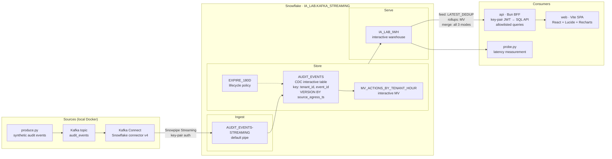

# streaming-kafka

Stream events from Kafka straight into a Snowflake **CDC interactive table**,
and query them seconds later from an **interactive warehouse**: deduplicated,
with no landing table, MERGE job or dedup pipeline in between.

You run a local Kafka with the Snowflake Kafka connector v4, a synthetic
producer of multi-tenant audit events (about 30% duplicates), a latency probe
and a live dashboard.



How to read it, from left to right:
- **Sources.** Synthetic events, some of them duplicate re-fetches, flow through
Kafka into the v4 sink.
- **Ingest.** The sink writes to the table's auto-created default pipe, using
the Snowpipe Streaming high-performance architecture.
- **Store.** One CDC table holds every version of every event, and a background
merge keeps one row per key. An interactive materialized view rolls it up by
hour, and a lifecycle policy expires rows older than 180 days.
- **Serve.** The interactive warehouse has both objects attached, so new data is
warmed into its cache. Queries over the 5-second limit fall back to `IA_LAB_WH`.
- **Consumers.** Each dashboard panel and probe run picks a `DEDUP_OPTION`:
  - `LATEST_DEDUP`: fresh and deduplicated.
  - `LAST_DEDUP`: fast, but lags minutes behind.
  - `LATEST_ALL`: every version, which is the audit view.

The dashboard's **Send test event** button and `probe.py` also write single
events back into Kafka. Those aren't drawn, to keep the diagram one-directional.

> **Grounded in** the Snowflake docs for interactive tables and warehouses
> (`user-guide/interactive`, `CREATE INTERACTIVE WAREHOUSE`), the preview docs
> for interactive streaming and interactive CDC, `CREATE STORAGE LIFECYCLE
> POLICY`, and the Kafka connector install docs, read 2026-10-30. Interactive
> CDC is in preview, so re-check the docs if anything behaves differently.

## Quickstart

```sh
cp .env.example .env      # set SF_ACCOUNT; the defaults are fine for everything else
just up <connection>      # every step below, verified as it goes
```

Then open http://localhost:8000 and click **Take the tour**. When you're done,
see [Stop and teardown](#step-16--stop-and-teardown). The interactive warehouse
bills while it runs.

`<connection>` is a `snow` CLI connection (`snow connection list`) whose role
can create roles, users, databases and warehouses. `ACCOUNTADMIN` is used for
the CDC probe and the user checks.

## Prerequisites

- A Snowflake account with **Interactive CDC** enabled. It's in preview, so ask
your Snowflake account team. `just doctor` tells you whether you have it.
- `snow` CLI, `just`, `docker` with `docker compose`, `openssl`, `jq` and
`curl`.

Python (for the producer and probe) and Bun (for the dashboard) run in Docker,
so you don't install either.

## Objects

| Name | Object |
|---|---|
| `IA_LAB_RL` | lab role; owns everything |
| `IA_LAB.KAFKA_STREAMING` | database and schema |
| `IA_LAB_WH` | standard XS warehouse, for DDL and query fallback |
| `IA_LAB_IWH` | interactive XS warehouse, for serving |
| `IA_KAFKA_SVC` | ingest service user, with key-pair auth |
| `IA_DASH_RL` / `IA_DASH_SVC` | read-only role and service user for the dashboard |
| `AUDIT_EVENTS` | CDC interactive table |
| `MV_ACTIONS_BY_TENANT_HOUR` | interactive materialized view |
| `EXPIRE_180D` | storage lifecycle policy |

## Walkthrough

`just up` runs these steps in order. Run them yourself to follow along. Every
Verify can be re-run with `just check <connection> <NN_name>`.

### Step 0 — Preflight

**Why.** Interactive CDC is a preview feature, and you can't see from the
account whether it's enabled. `doctor` probes for it by creating a throwaway CDC
table in a transient database, then dropping it whether or not it worked. If the
probe fails, nothing from Step 4 onwards will work.

**Do.** `just doctor <connection>`

**Verify.** Every line shows `✓`, ending with `✓ Interactive CDC enabled`. If it
can't reach Snowflake, check your network access and the connection name.

### Step 1 — Config

**Why.** Everything that isn't a secret lives in `.env`, which `just` loads
automatically. Object names are hard-coded in the SQL to match the table above.

**Do.** `cp .env.example .env`, then set `SF_ACCOUNT` to your `<org>-<account>`
identifier. `doctor` prints it as `account_identifier`.

**Verify.** `just --list` runs without errors.

### Step 2 — Key pair

**Why.** Snowpipe Streaming and the SQL API both require key-pair auth. The key
is unencrypted PKCS#8, as the connector requires. It's gitignored.

**Do.** `just keys`

**Verify.** `keys/rsa_key.p8` and `keys/rsa_key.pub` both exist. If you
regenerate the keys later, re-run `just service-user` (Step 3) to register the
new public key, then `just sink-add` (Step 7) so the connector picks it up.

### Step 3 — Role, database and service user

**Why.** One lab role owns everything, so grants stay simple and teardown is a
few drops. The ingest user is `TYPE = SERVICE`. Its public key is injected into
`data/migrations/002_service_user.sql` at run time, through a temporary file, so
it's never committed.

**Do.**
```sh
just setup <connection>          # data/migrations/001_init.sql
just service-user <connection>   # data/migrations/002_service_user.sql
```

**Verify.** `just check <connection> 03_service_user`. Compare
`RSA_PUBLIC_KEY_FP` in the `DESC USER` output with `just fingerprint`. They must
match.

### Step 4 — The CDC interactive table

**Why.** This one table is the whole store. Kafka writes straight into it, and
it deduplicates on its own (`data/migrations/003_events_table.sql`):
- **`PRIMARY KEY (tenant_id, event_id) INITIALLY DEFERRED`** declares an event's
logical identity. It isn't enforced on write. Duplicates are appended, and a
background merge keeps one row per key.
- **`VERSION BY source_egress_ts`** decides which duplicate wins: the most
recent fetch from the source.
- **`CLUSTER BY` is required.** It leads with `tenant_id`, the column every
serving query filters on, and then a time bucket.
- **Schema evolution** turns new JSON fields into columns.
- **Two `*_ts` columns** stamp each hop, for measuring latency.

CDC tables accept **streaming ingest only**: no `INSERT`, no `COPY`.

**Do.** `just events-table <connection>`

**Verify.** `just check <connection> 05_table_ready` (shared with Step 5) shows
the table. If the step fails with *"VERSION BY expression is not supported"*,
CDC isn't enabled; go back to Step 0.

### Step 5 — The interactive warehouse

**Why.** Interactive tables perform best on an interactive warehouse. Attaching
the table with `TABLES (...)` means new data is warmed into the cache as it
arrives (`data/migrations/004_interactive_wh.sql`).

> **Billing:** a 1-hour minimum on every resume, and auto-suspend can't be set
> below 24 hours. Use `just stop` when you take a break.

**Do.** `just iwh <connection>`

**Verify.** `just check <connection> 05_table_ready` shows `IA_LAB_IWH`, and the
`COUNT(*)` runs on it and returns 0.

### Step 6 — Local Kafka and Connect

**Why.** Connector **v4** (`SnowflakeStreamingSinkConnector`) uses the
high-performance Snowpipe Streaming architecture and writes to the table's
default pipe. The recipe downloads the connector and the two Bouncy Castle FIPS
JARs it needs into `plugins/`, starts ZooKeeper, Kafka and Connect from
`compose.yaml`, and creates a topic with three partitions.

**Do.**
```sh
just kafka-up
just kafka-plugins
```

**Verify.** `kafka-plugins` prints
`com.snowflake.kafka.connector.SnowflakeStreamingSinkConnector`.

### Step 7 — Register the sink

**Why.** `scripts/register_sink.sh` builds the connector config from `.env` and
the private key, then sends it to Connect with `PUT`, so re-running it updates
the config rather than failing. It maps the topic to `AUDIT_EVENTS`.

**Do.**
```sh
just sink-add
just sink-status
```

**Verify.** `sink-status` shows the connector and all three tasks as `RUNNING`.
Then `just check <connection> 07_pipe` shows the auto-created
`AUDIT_EVENTS-STREAMING` pipe. If a task shows `FAILED`, check `docker compose
logs connect` for the error.

### Step 8 — Produce events and watch them land

**Why.** `scripts/produce.py` generates synthetic audit events across 20
tenants. It runs in the `tools` container (`scripts/Dockerfile`), which reaches
Kafka at `kafka:29092` on the compose network. `--dup-rate` re-sends that
fraction of events later with a newer `source_egress_ts`, which simulates a
source being re-fetched.

**Do.**
```sh
just tools                                # build the producer + probe image
just produce --count 1000 --dup-rate 0.3
```

**Verify.** Within seconds, `just check <connection> 08_landed` shows about
1,300 rows (1,000 events plus about 300 duplicates) across 20 tenants. The
`DESCRIBE` shows any columns schema evolution added.

### Step 9 — Prove the dedup

**Why.** Each query can choose a different view of the same table:

| `DEDUP_OPTION` | Returns | Use it for |
|---|---|---|
| `LATEST_ALL` | every ingested version | audit, ground truth |
| `LATEST_DEDUP` | one row per key, merged as you query | fresh reads |
| `LAST_DEDUP` | what the background merge has finished | fast scans that can lag minutes |

The ground truth comes from the table itself, `COUNT(DISTINCT key)` over
`LATEST_ALL`, so you don't need a second "raw" table.

**Do.** `just check <connection> 09_dedup`

**Verify.**
- `LATEST_DEDUP` equals `logical_events`, which is less than `versions`.
- `LAST_DEDUP` starts at 0 and catches up within a few minutes.
- The spot check shows one duplicated key's versions, with the newest
`source_egress_ts` as the winner.

### Step 10 — Measure latency

**Why.** The goal is for an event to be queryable **well under 60 seconds**
after it leaves the source. `scripts/probe.py` stamps one event, produces it,
then polls the interactive warehouse until it's visible. The wall-clock time
covers Kafka, the connector, ingest and the query together.

**Do.**
```sh
just probe --dedup LATEST_DEDUP
just probe-all        # all three modes, back to back
```

**Verify.** `LATEST_DEDUP` and `LATEST_ALL` report a median of a few seconds.
`LAST_DEDUP` takes minutes or times out, which is why it can't back a fresh
view.

### Step 11 — Rollups and retention

**Why.**
- **Rollups.** Dynamic tables and streams can't use an interactive table as a
source, so the way to precompute aggregates is an **interactive materialized
view**, attached to the warehouse along with its base table
(`data/migrations/005_rollups.sql`).
  - This step is an **experiment**: the docs don't say whether a materialized
  view can sit on a CDC table. The recipe is allowed to fail. The dashboard uses
  the view when it exists and a direct aggregate when it doesn't.
- **Retention.** A storage lifecycle policy on `event_ts` expires rows after 180
days (`data/migrations/006_retention.sql`).

**Do.**
```sh
just rollups <connection>
just retention <connection>
```

**Verify.** `just check <connection> 11_rollups_retention`:
- **Rollups:** the materialized view's total matches the `latest_all` count, not
the deduped one. It counts every ingested version, so the dashboard only uses it
in *All versions* mode.
- **Retention:** the policy is listed.
- **Re-running:** `just retention` fails the second time, because the policy is
already attached. `just up` skips it when the policy exists.

### Step 12 — Read-only dashboard user

**Why.** The dashboard gets its own key pair, a `TYPE = SERVICE` user and a
read-only role with `USAGE` and `SELECT` only, separate from ingest. Each can be
rotated without breaking the other. The migration also sets `FALLBACK_WAREHOUSE`
on the interactive warehouse, so queries over 5 seconds re-run on `IA_LAB_WH`
instead of failing (`data/migrations/007_dashboard.sql`).

**Do.**
```sh
just dash-keys
just dashboard-user <connection>
```

**Verify.** `just check <connection> 12_dashboard_user` shows the user, and
shows that `IA_DASH_RL` has only `USAGE` and `SELECT` grants.

### Steps 13–14 — Dashboard

**Why.**
- **The browser never holds credentials.** `api/` is a Bun + Elysia BFF that
signs a key-pair JWT, and it's the only thing that talks to Snowflake, through
the SQL API.
- **The BFF runs a fixed set of queries:**
  - `DEDUP_OPTION` is checked against an allowlist, because it can't be bound.
  - Tenant IDs are validated against a pattern.
  - Every other value is a bound parameter.
- **The UI is `web/`:** Vite, React and Recharts, served by nginx, which proxies
`/api/*` to the BFF.
- **Each panel maps to one consumer from the diagram,** and shows its query
time.
- **The tenant picker is a filter, not isolation.** There's no identity provider
here.

**Do.** `just app-up`, then open http://localhost:8000. To work on the UI with
hot reload, run `just web-dev` (http://localhost:5173). It runs Vite in a
container with `web/` mounted, against the BFF container.

**Verify.**
- `curl localhost:8001/api/health` returns `IA_DASH_SVC`, `IA_DASH_RL` and
`IA_LAB_IWH`.
- `curl localhost:8001/api/tenants` lists 20 tenants.
- `curl 'localhost:8001/api/events?tenant=BAD!'` returns `400`.

### Step 15 — Run the demo

**Do.** Start a continuous stream of about 50 events/s for about 7 minutes:
```sh
just produce --count 20000 --rate 50 --dup-rate 0.3
```
Then, at http://localhost:8000:
1. Click **Take the tour** for a guided walkthrough.
2. Watch **Freshness**. With the stream running, it should sit at a few seconds.
3. Click **Send test event** in each mode. The line fills as the event is sent,
   acknowledged by Kafka, and then queryable. The number is the whole trip.
4. Watch **Deduplication**. *Last merged* climbs toward *Logical events* as
   background merges run.

**Verify.** Test events in **Latest · deduped** are visible in single-digit
seconds, roughly matching `just probe`. **Last merged** takes minutes. To see
which queries fell back past 5 seconds:
```sql
SELECT start_time, warehouse_name, total_elapsed_time, LEFT(query_text, 80) AS q
FROM TABLE(IA_LAB.INFORMATION_SCHEMA.QUERY_HISTORY_BY_USER(USER_NAME => 'IA_DASH_SVC', RESULT_LIMIT => 200))
ORDER BY start_time DESC;
```

### Step 16 — Stop and teardown

**Why.** The interactive warehouse bills a 1-hour minimum on every resume, and
it won't auto-suspend for 24 hours. Leaving it running is the expensive mistake.

**Do.**
```sh
just stop <connection>       # pause: stop containers, suspend IA_LAB_IWH
just teardown <connection>   # remove: sink, containers, volumes, images, every Snowflake object
just clean-local             # optional: delete keys/ and plugins/ (keeps .env)
```

**Verify.** `just check <connection> 16_teardown`. Every `SHOW` returns no rows.

## Recipe cheat sheet

| Recipe | What it does |
|---|---|
| `up <conn>` | every step, end to end, verified |
| `doctor <conn>` | preflight: tools, account, CDC probe |
| `check <conn> <name>` | run `data/checks/<name>.sql` |
| `keys` / `dash-keys` / `fingerprint` | key pairs, and the local fingerprint |
| `setup` / `service-user` / `events-table` / `iwh <conn>` | Snowflake objects for Steps 3–5 |
| `kafka-up` / `kafka-plugins` | local Kafka and Connect |
| `sink-add` / `sink-status` | register the sink and check it |
| `tools` / `produce *args` / `probe *args` / `probe-all` | producer and latency probe, in Docker |
| `rollups` / `retention <conn>` | materialized view (experiment) and lifecycle policy |
| `dashboard-user <conn>` | read-only user and fallback warehouse |
| `api-up` / `api-logs` / `app-up` / `web-dev` | dashboard |
| `stop` / `teardown <conn>` / `clean-local` | pause, remove, clean |

## What to try next

- **Scale it.** Raise `--rate` and `--tenants`, resize `IA_LAB_IWH`, and watch
latency, query times and credits.
- **Test the fallback.** Remove a filter or a `LIMIT` from a BFF query, and find
the re-run on `IA_LAB_WH` in query history.
